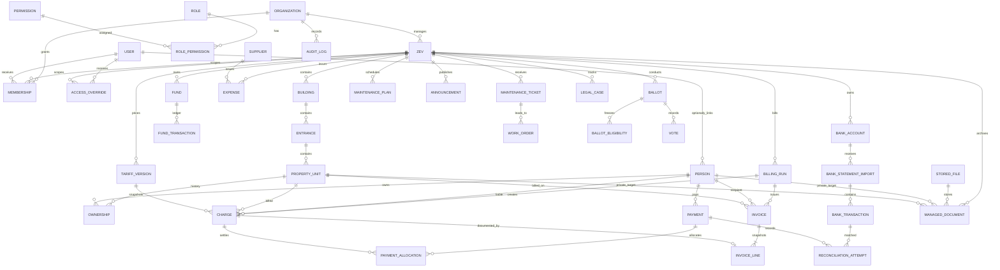

# Konceptualni ERD

Finansije V2, faza 2 (aditivna migracija `20260930200000_InvoiceLifecycle`):

```text
BillingRun → Invoice → InvoiceLine → Charge (+)
                │             │           ↑
                └→ FinancialDocument → FinancialDocumentLine → Charge (-/+)
                     │                                     └→ ReversesChargeId (za -)
                     └→ PaymentAllocation (-) → ReversesAllocationId → PaymentAllocation (+) → Payment → BankTransaction
```

`FinancialDocument.OriginalInvoiceId` i tenant-scoped FK čuvaju vezu; `RequestId`, serijski broj i storno-original imaju unique indekse. Negativna alokacija oslobađa sredstva uplate, ne mijenja originalnu uplatu. Historijski ERD ispod opisuje starije faze i nije potpuna slika Finansija V2.

Faza 1.1 dodaje opcionalnu vezu `Charge.TariffVersionId → TariffVersion.Id` i opcionalni `InvoiceLine.TariffVersionId`, bez promjene obaveznih veza `InvoiceLine → Charge → Fund`. `Fund.RequiresBankAccountForInvoice` određuje blokirajući preflight. Migracija `20260930190000_InvoiceV2Stabilization` proširuje nullable kolone i rekreira odgovarajuće indekse/FK bez brisanja finansijskih redova.

Ovaj ERD uključuje aditivnu `20260930180000_InvoiceV2` migraciju; historijski opisi starijih prolaza su u `FINAL_TECHNICAL_CLOSURE.md`. Migracija još nije primijenjena na postojeću bazu u ovom radu.

Ovo je sažet izvedeni logički model nakon Faza 2–9. `OrganizationId` je tenant ključ, `ZevId` je podscope. Identifikatori su UUID; finansijski iznosi su `decimal`.



## Ključevi i ograničenja

**Aktuelne veze Payments V2 (01.10.2026):** `Zev 1—N Invoice 1—N InvoiceLine N—1 Charge N—1 Person`; `Payment 1—N PaymentAllocation N—1 Charge`; `BankTransaction 0..1—1 Payment` samo za bankovni izvor. Ručni Payment ima `BankTransactionId=NULL`, `RequestId`, `ManualReason`, `ManualMethod` i opciono `ManualUnitId`. Negativni PaymentAllocation referencira original preko `ReversesAllocationId`. Migracija `20261001100000_PaymentsV2` dodaje filtrirane jedinstvene indekse za bankovni FK i ručni request ID, te CHECK za izvor i znak alokacije. Stari opis ispod da Invoice tabela ne postoji je historijski.

- `Zev`: `UNIQUE(OrganizationId, Code)`; `Membership`: `UNIQUE(UserId, OrganizationId, ZevId, Role)` (za nullable ZevId koristiti filtrirane indekse).
- `Ownership`: FK na unit/person, interval `[ValidFrom, ValidTo)`, `CHECK(Share > 0 AND Share <= 1)`, `CHECK(ValidTo IS NULL OR ValidTo > ValidFrom)`; preklapanja provjerava transakcijski servis pod serijalizacijom.
- `TariffVersion`: `UNIQUE(ZevId, Code, Version)` i servisna provjera vremenskog intervala. `BillingRun`: `UNIQUE(ZevId, Period)`; `Charge` čuva snapshot verzije, osnove i osobe.
- `PaymentAllocation`: `CHECK(Amount > 0)` i transakcijska provjera da zbir ne prelazi uplatu ili otvoreno zaduženje. `BankStatementImport`: `UNIQUE(ZevId, BankAccountId, ChecksumSha256)`; `BankTransaction`: `UNIQUE(ImportId, Sequence)`. Nema nezavisnog bankovnog fingerprinta.
- `Vote`: unique po `BallotId` i posebnom dijelu. `FundTransaction` i knjižene finansijske tabele imaju EF zabranu hard-delete; rashod koristi reversal vezu.
- Indeksi obuhvataju `(ZevId, Period)` za obračun, `(PersonId, DueDate)` i jedinstveni `Reference` za zaduženja, `(ZevId, Reference)` za bankovne transakcije, `(ZevId, Status, CreatedUtc)` za prijave kvarova, plus organizacijski/ZEV scope i `rowversion` za promjenjive matične podatke.
- `Person.UserLinkStatus` je `Pending` po defaultu i indeksiran uz `UserId`; verifikacija je admin workflow, ne FK dokaz identiteta. `AccessOverride` ima FK na korisnika, aktera i `(OrganizationId,ZevId)`, datumsku CHECK zaštitu i indeks `(UserId,ZevId,PermissionKey,ValidFromUtc)`. `ManagedDocument` ima opcionalni composite FK na property unit i `TargetRole`; `PersonId` ostaje opciono ciljanje osobe.

Finansijski dodatak 28.09.2026: `TariffVersion` sada ima `Description`, `IsOptional`, `ShowOnInvoice`, `DisplayOrder`; `Charge` ima `Note`, `IsManualOverride`; `Payment` ima `Status` (`Posted`/`Reversed`) i `ReversedOn`. Nema nove `Invoice` tabele: grupisanje `(ZevId, PropertyUnitId, PersonId, Period)` nad `Charge` je račun, a svaki `Charge` jedna linija. Puni povrat je put `BankTransaction (negativan) → ReconciliationAttempt.PaymentId → Payment` i `FundTransaction.ReversesTransactionId → originalni FundTransaction`; izvorni `PaymentAllocation` red se ne briše.
